<div align="center">

# Morphit

**Convert any file on Windows with one gesture — offline, private, instant.**

Hold <kbd>Ctrl</kbd>, drag a file, let go on the format you want. That's it.

[](../../releases/latest)


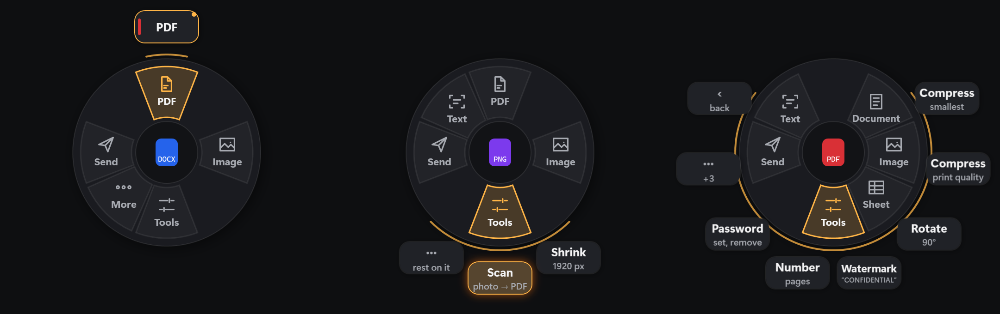

</div>

---

## Contents

- [Why Morphit](#why-morphit)
- [How it works](#how-it-works)
- [Features](#features)
- [What it converts](#what-it-converts)
- [Privacy](#privacy)
- [Download and install](#download-and-install)
- [Using Morphit](#using-morphit)
- [Command line](#command-line)
- [FAQ](#faq)
- [Feedback](#feedback)
- [License](#license)

---

## Why Morphit

Converting a file usually means opening a program, finding the right menu, choosing a format, picking a folder — or
uploading a confidential document to a website. Morphit removes all of that:

- **One gesture, no window.** The choices open right under the cursor, where the file already is.
- **Nothing leaves your computer.** No uploads, no accounts, no telemetry — Morphit contains no network code at all.
- **Everything included.** PDF, video, archive and OCR engines ship inside the installer; nothing is downloaded at
  install time.
- **Results land next to the original.** The original is never changed or overwritten.

## How it works

1. **Point at a file** in Explorer, on the desktop or in an Outlook e-mail.
2. **Hold <kbd>Ctrl</kbd> and drag it a little** — the *orbit* opens instantly around the cursor.
3. **Let go on a format.** The file is converted and the result appears next to the original.

Drag on past the orbit and it steps aside with a short *Regular copy* note: Windows' own <kbd>Ctrl</kbd>+drag copy
keeps working exactly as before.

<p align="center">
  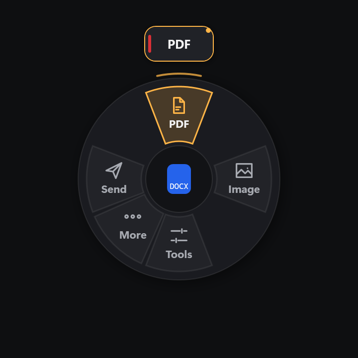
  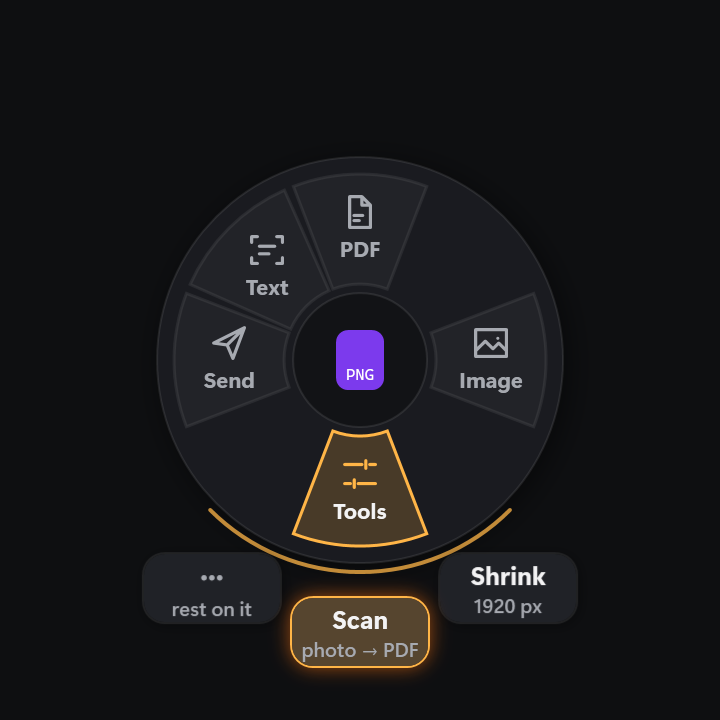
  
</p>

The categories always sit in the same place — **PDF on top, Tools at the bottom, Send on the left** — so after a few
uses your hand finds them without looking. The most useful choices come first; rarer ones wait behind **···**.

## Features

### The orbit
- Opens on <kbd>Ctrl</kbd>+drag, a drop on the tray panel, *Send to → Morphit* or the command window.
- Smart suggestions: a large PDF is offered **Compress**, a large video or photo **Shrink** (marked with ✦).
- Real progress for video, audio, OCR, scans and PDF → Office, with a **✕** that stops the job and leaves nothing
  half-written behind.
- Several jobs at once: start a new orbit while another one is still working.
- Keyboard: <kbd>←</kbd>/<kbd>→</kbd> category, <kbd>↑</kbd>/<kbd>↓</kbd>/<kbd>Tab</kbd> choice, <kbd>Enter</kbd> run,
  <kbd>Esc</kbd> cancel; <kbd>Shift</kbd>+click opens a tool's options.

<p align="center">
  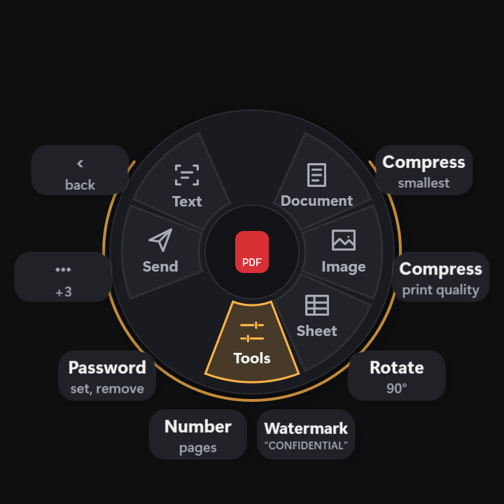
  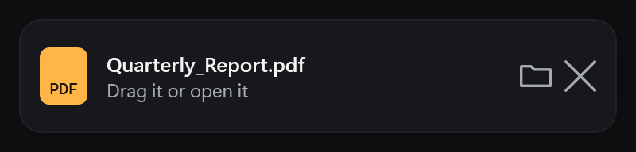
</p>

### Tools

| Tool | What it does |
|---|---|
| **Pages** | Pick, reorder, delete or split PDF pages on a visual thumbnail grid |
| **Merge** | Word, pictures and PDFs, mixed, into one PDF — in natural order (*2* before *10*), reorderable |
| **Compress** | PDF in three levels: standard, smallest, print quality |
| **Shrink** | Pictures to a sensible size; video to 720p MP4 for e-mail |
| **Scan** | Phone photos of documents → straightened, black-and-white, A4 PDF |
| **Searchable** | Invisible OCR text on scanned PDFs, so <kbd>Ctrl</kbd>+<kbd>F</kbd> works |
| **Stamp** | Your stamp or signature on the last page (white background made transparent) |
| **Password** | Protect a PDF with AES-256, or remove a password you know |
| **Watermark · Number · Rotate** | Watermark text, page numbers, 90/180/270° — options with <kbd>Shift</kbd>+click |
| **Hide personal data** | Finds and covers national IDs, phone and card numbers, IBANs, e-mails, passports, IPs, tokens |
| **Clean** | Removes metadata (author, GPS, software) from documents and pictures |
| **Trim · Mute · Frame** | Cut a video or audio clip, drop the sound, save a frame as PNG |
| **ZIP / Unzip** | Create ZIP; open ZIP, 7z and RAR |
| **Send → Outlook** | Zips the files and opens a new Outlook e-mail with the ZIP attached (never sends it) |

### Recipes
Chain steps into one choice — for example *Contract: PDF → Stamp → Password → Outlook*. Recipes appear first under
Tools; the result is named `name (Recipe).pdf` and the original is left untouched.

<p align="center">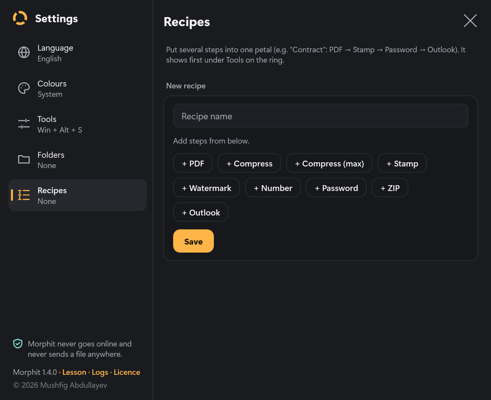</p>

### Tray panel
A calm home for everything else: drop or choose files, one-click quick tools, your last results (click to open, undo,
show in folder), the full searchable history, and this month's count of converted files and space saved.

<p align="center">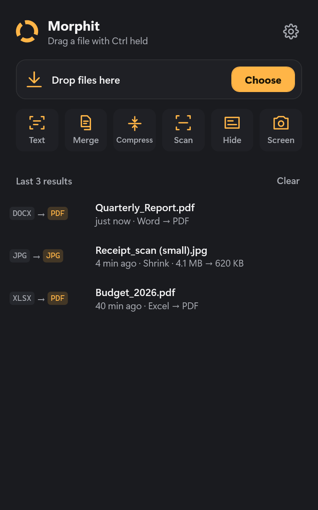</p>

### Screenshot to text
<kbd>Win</kbd>+<kbd>Alt</kbd>+<kbd>S</kbd>: select an area — it is saved as PNG and its text, read by OCR, is copied
to the clipboard. A *safe screenshot* variant covers personal data before saving.

### Command window
<kbd>Win</kbd>+<kbd>Alt</kbd>+<kbd>M</kbd> lists every choice for the files selected in Explorer, filtered as you
type (*“compress print”*, *“stamp”*) — including the rarer tools and your recipes.

### Watched folders
Any file dropped into a watched folder is converted automatically (for example, everything to PDF, or large photos
shrunk to 2560 px); originals move to a *Done* subfolder.

### First-run lesson
A short, interactive lesson on one stage: watch the gesture, press **Your turn**, then do it yourself with a guide
that points at each step — hold <kbd>Ctrl</kbd>, drag the file, let go on PDF.

<p align="center">
  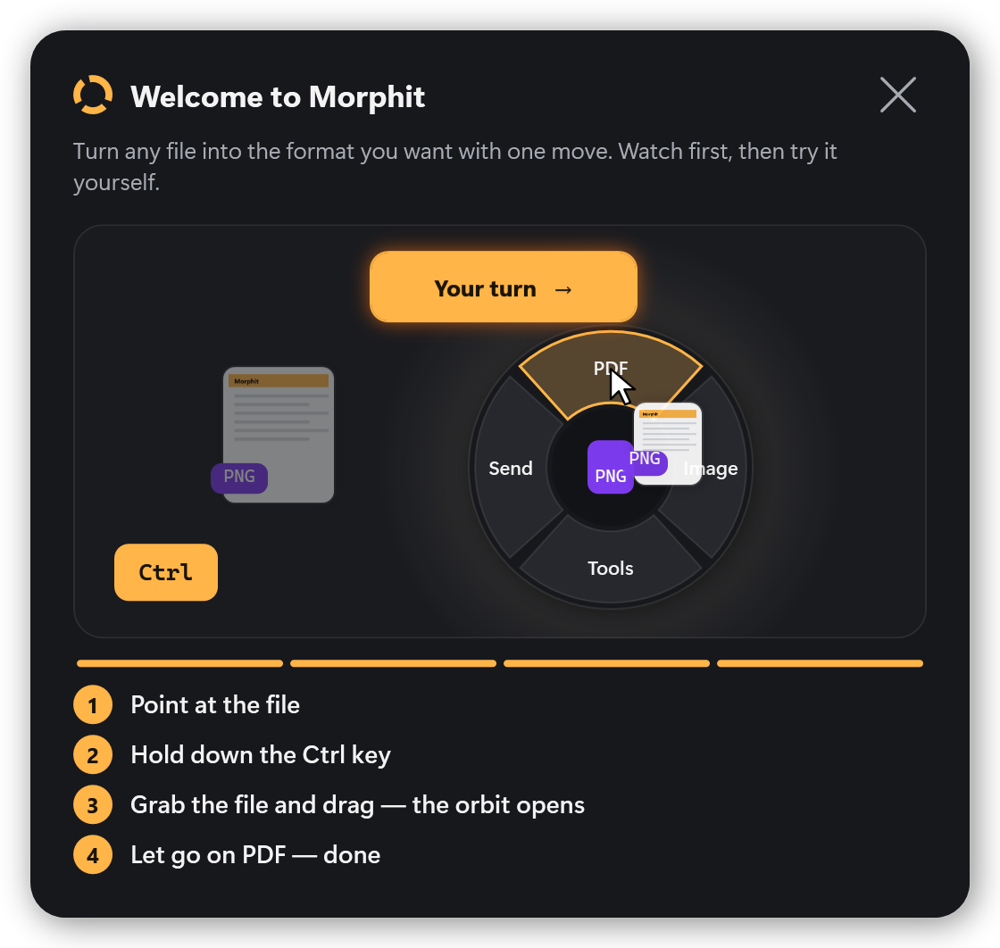
  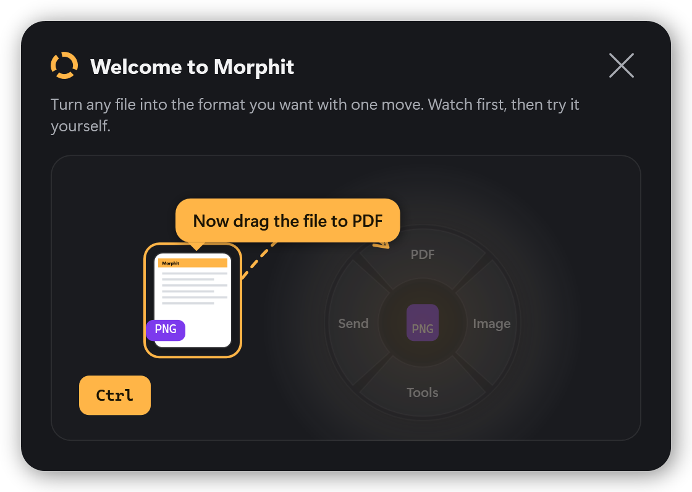
  
</p>

### Look and feel
- Light, dark or *follow Windows*; Mica and rounded corners on Windows 11; the Windows accent colour or your own.
- High-contrast themes and Windows text size (100–150%) respected; clear keyboard focus everywhere.
- Four interface languages: **English, Azərbaycan dili, Türkçe, Русский** (picked from Windows on first start).

<p align="center">
  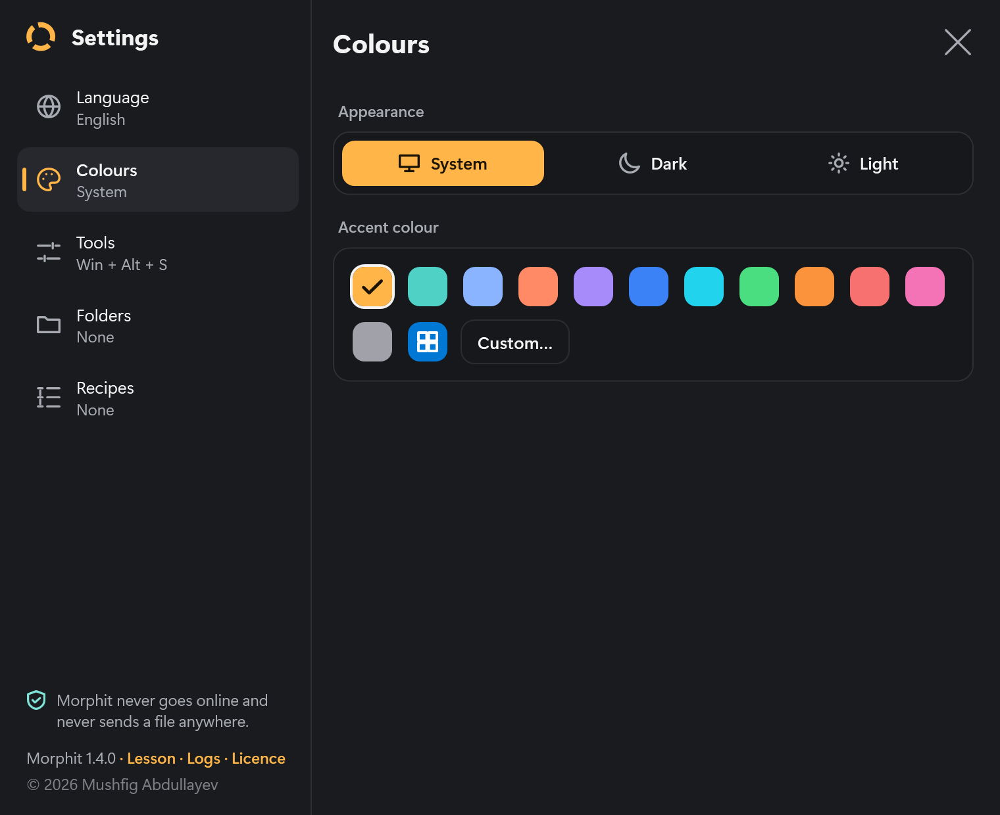
  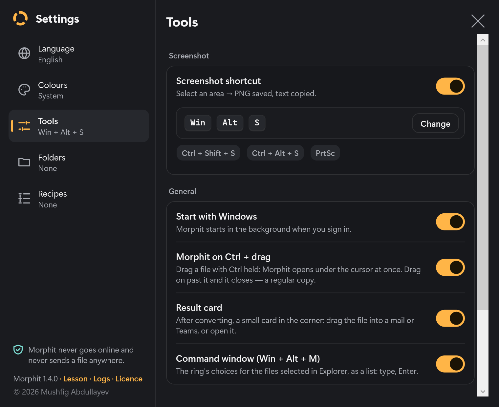
</p>

## What it converts

The route is found automatically, through intermediate formats when needed (e.g. HEIC → PNG → PDF).

| Area | Formats |
|---|---|
| Pictures | PNG, JPG, WebP, GIF, BMP, TIFF, ICO, HEIC, AVIF (read); pictures → PDF |
| PDF | Merge, split, compress, pages, password, stamp, watermark, page numbers; PDF → pictures; EPS/PS → PDF |
| Office documents | Word / Excel / PowerPoint ↔ PDF, DOC, RTF, ODT, XLS, ODS, CSV, PPT, ODP; TXT → PDF / Word |
| Tables | Word tables → Excel sheets, Excel sheets → Word tables |
| PDF → Office | PDF → Word, Excel or text (text pages directly, scanned pages by OCR) |
| Video | MP4, MOV, MKV, WebM, AVI, WMV ↔ MP4/MOV/MKV/WebM/AVI; video → GIF |
| Audio | MP3, M4A, WAV, OGG, FLAC; audio from video |
| Archives | ZIP (create, open), 7z and RAR (open) |
| OCR | Azerbaijani, English, Russian, Turkish |

> Word, Excel and PowerPoint conversions use the Microsoft Office installed on your PC. Morphit never closes or
> touches your open documents, and opens files read-only with macros disabled.

## Privacy

- **Offline by design.** Morphit contains no network code — it cannot upload anything, anywhere.
- **No telemetry, no accounts, no cloud.** Settings and history stay on your PC in `%APPDATA%\Morphit`.
- **Never overwrites.** Results get a new name (`name (2).ext`); cancelled jobs leave nothing half-written.
- **Office safety.** Macros forced off, files opened read-only, password-protected files fail fast instead of opening
  a dialog.

## Download and install

1. Download **`Morphit.Setup.exe`** from the [latest release](../../releases/latest).
2. Run it. Installing *for me only* needs no administrator rights. Accept the licence and choose whether Morphit
   starts with Windows.
3. Morphit opens a short lesson. After that it lives in the tray, next to the clock.

**Requirements:** Windows 10 (1809) or later, 64-bit. Microsoft Office is needed only for Word, Excel and PowerPoint
conversions. Everything else is included.

> The installer is not code-signed yet, so Windows SmartScreen may say *Windows protected your PC* /
> *Unknown publisher*. Choose **More info → Run anyway**. You can check the download against the SHA-256 published
> with each release.

**Updating:** run the new Setup over the old one — your settings and history are kept.
**Uninstalling:** Settings → Apps → Installed apps → Morphit.

## Using Morphit

| Action | How |
|---|---|
| Convert | <kbd>Ctrl</kbd>+drag a file, let go on a format |
| Choose instead of dragging | Tray icon → **Choose**, or Explorer → *Send to → Morphit* |
| Cancel the orbit | Move back to the centre, or <kbd>Esc</kbd> |
| Stop a running job | The **✕** in the middle of the spinner |
| Rarer tools | Rest on **···** |
| Tool options | <kbd>Shift</kbd>+click (Rotate, Number, Watermark, Stamp) |
| Text from the screen | <kbd>Win</kbd>+<kbd>Alt</kbd>+<kbd>S</kbd> |
| Command window | <kbd>Win</kbd>+<kbd>Alt</kbd>+<kbd>M</kbd> |
| Outlook attachments | Drag them straight from the e-mail onto the orbit or the tray panel |
| The lesson again | Tray icon → right-click → **Lesson** |

## Command line

`morphit-cli.exe` is installed next to the app, for scripts and batch jobs:

```text
morphit-cli convert <files...> --to <format> [-o <folder>] [--quality 1-100] [--max 1920x1080] [--dpi 150]
morphit-cli merge <pdfs...> -o <result.pdf>
morphit-cli split <pdf> [-o <folder>]
morphit-cli compress <pdf> [-o <result.pdf>] [--level small|screen|print]
morphit-cli zip <files or folders...> -o <archive.zip>
morphit-cli unzip <archive> [-o <folder>]
morphit-cli formats [<format>]
morphit-cli engines
```

## FAQ

**Does Morphit upload my files?**
No. It has no network code at all; every conversion runs on your PC.

**Is it free?**
Yes, you can download and use it for your own work. See the [licence](LICENSE.txt) for the terms.

**Does <kbd>Ctrl</kbd>+drag still copy files?**
Yes. If you drag on past the orbit, it closes and Windows copies the file as usual.

**Why does Windows warn about the installer?**
The installer is not code-signed yet. Choose **More info → Run anyway**, or compare its SHA-256 with the one in the
release notes.

**Can I turn the orbit off?**
Yes: Settings → Tools → *Morphit on Ctrl + drag*. You can still use the tray panel and *Send to → Morphit*.

**Do I need Microsoft Office?**
Only for Word, Excel and PowerPoint conversions. Pictures, PDF, video, audio, archives and OCR work without it.

## Feedback

Found a bug or missing a format? [Open an issue](../../issues/new) — a short description, the file type and, if
possible, a screenshot help a lot. The log folder (Settings → **Logs**) is useful for errors.

## License

**Copyright © 2026 Mushfig Abdullayev. All rights reserved.**

Morphit is free to download and use, but it is proprietary software: copying, redistributing, modifying, decompiling
or reusing it — in whole or in part, including its design — is not permitted without the author's written
permission. See [`LICENSE.txt`](LICENSE.txt) (Azerbaijani and English).

Third-party components delivered with Morphit are governed by their own licences — Ghostscript (AGPL-3.0),
FFmpeg (GPL-3.0), 7-Zip (LGPL), Tesseract (Apache-2.0), Magick.NET / ImageMagick, PDFsharp (MIT), .NET (MIT) and
Feather icons (MIT). See [`THIRD-PARTY-NOTICES.txt`](THIRD-PARTY-NOTICES.txt) and the [`licenses`](licenses) folder.

<div align="center">
<sub>Made by Mushfig Abdullayev</sub>
</div>
